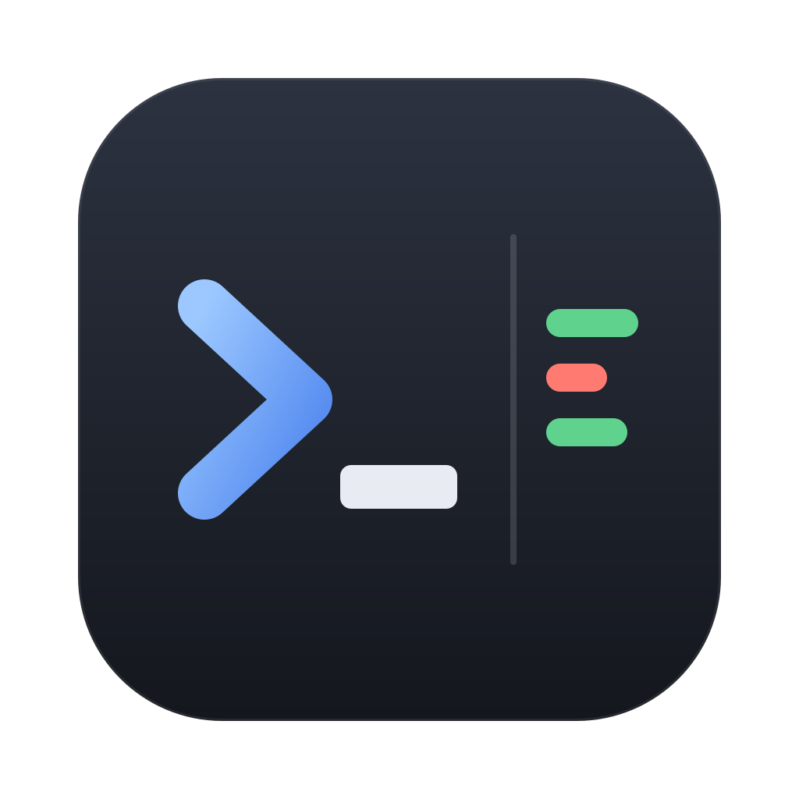
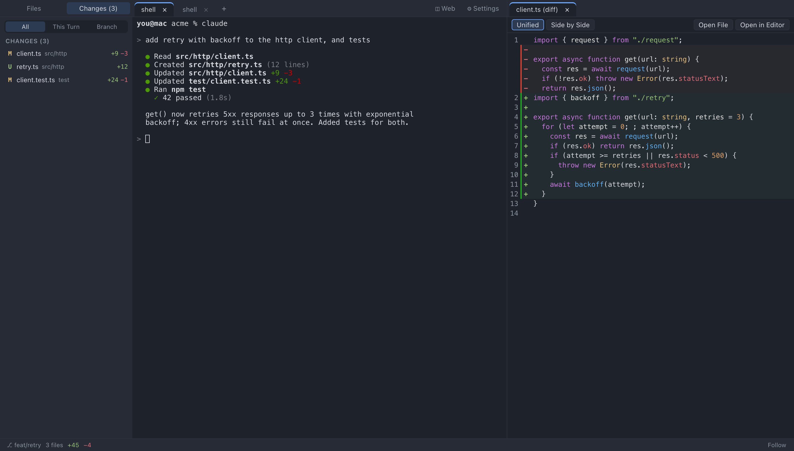

<div align="center">



# tine

**The terminal for working with AI coding agents.**

Run Claude Code, Codex or any CLI agent and review its changes live, on one screen.

[](LICENSE)




</div>

## Features

- **Live changes:** every file the agent touches, with line counts and a unified or side-by-side diff.
- **This Turn / Branch:** only the changes since your last prompt, or everything since the branch left `main`.
- **Follow mode:** opens each diff as the agent writes it, without taking focus from the terminal.
- **Agent status:** tabs show when an agent is working, done, or waiting for your permission.
- **Point at code:** select lines and press Cmd+L to send `path:12-18` to the agent.
- **Full terminal:** tabs, split view, command blocks, clickable paths, GPU rendering.
- **Files:** a tree that follows your shell, previews, light editing, search in files, Open in Editor (VS Code, Cursor, Zed).
- **Web panel:** docs, a dev server or a video in place of the viewer, with bookmarks.
- **Restricted tabs (macOS):** a shell, and everything it starts, that can write only to its own folder and cannot read your keys.
- **Isolated tabs:** a root shell in a throwaway Docker container that sees only its folder.

No built-in AI, account or telemetry. A Rust core on the system webview, under 20 MB.

## Install

Releases are not published yet; build from source:

```sh
git clone https://github.com/arwenizEr/tine && cd tine
npm install
npm run app            # bundle in core/target/release/bundle/
npm run install-app    # macOS: build and copy to /Applications
```

Requires Rust (stable), Node.js 22+, and Xcode Command Line Tools on macOS or the [WebKitGTK packages](https://v2.tauri.app/start/prerequisites/) on Linux.

On first start, macOS users can grant **Full Disk Access** once instead of approving each folder.

## Keyboard shortcuts

On Linux, use Ctrl+Shift instead of Cmd (search in files: Ctrl+Alt+F).

| Shortcut | Action |
| --- | --- |
| Cmd+T / Cmd+W | New / close tab |
| Cmd+D | Split view |
| Cmd+P | Command palette (`>` for commands) |
| Cmd+Shift+F | Search in files |
| Cmd+F | Find |
| Cmd+K | Clear terminal |
| Cmd+Up / Cmd+Down | Previous / next command |
| Cmd+B / Cmd+J | Toggle file tree / viewer |
| Cmd+L | Send selected lines to the terminal |
| Cmd+S | Save file |
| Cmd+, | Settings |
| Shift+Enter | Newline in agent prompts |

## Settings

Use **⚙ Settings** for font, size, theme, shell and editor. Everything, including shortcuts, is stored in `~/.config/tine/settings.toml`:

```toml
font_size = 14
theme = "system"                           # system, light, dark
editor = "cursor"                          # vscode, cursor, zed
bookmarks = ["https://www.youtube.com/"]

[keybindings]
palette = "cmd+shift+p"
```

## Restricted tabs

**New Restricted Tab** (in the command palette) opens a shell under the macOS sandbox, in the active tab's folder. Every program started there inherits the sandbox:

- It can write only to that folder, temp folders and `~/.npm`, never to `.git/hooks` or `.git/config`. Commits work; `git init`, `clone`, `remote add` and `push -u` do not, so run those in a normal tab.
- It cannot read `~/.ssh`, `~/.aws`, `~/.gnupg`, keychains, browser cookies or other credential files.
- It cannot use `open`, AppleScript, `launchctl`, the keychain or local sockets such as Docker's; `sudo` and other setuid programs do not run.
- It refuses to start in your home folder, its parents, `~/Library` or a hidden folder in your home.

```toml
[sandbox]
network = false               # default true
writable = ["~/.npm"]         # replaces the default list
deny_read = ["~/secrets"]     # added to the built-in list
```

This protects against mistakes and careless tools, not against code written to break out. Files in the folder still run outside the sandbox the next time you use them: `package.json` scripts, a `Makefile`, hooks under a custom `core.hooksPath`.

**Claude Code in a restricted tab** gets its own config folder (`CLAUDE_CONFIG_DIR`, in tine's app data), because the real `~/.claude` and `~/.claude.json` hold hooks and MCP servers that run outside the sandbox. It cannot reach your keychain, so sign it in with a token: run `claude setup-token` once in a normal tab, then `export CLAUDE_CODE_OAUTH_TOKEN=…` in the restricted tab. Anything running in that tab can read the token. Claude Code's own sandbox cannot start inside this one; leave it off there.

## Isolated tabs

**New Isolated Tab (Docker)** runs `bash` as root in a new container (`debian:stable-slim` by default) that sees only the active tab's folder, at `/work`. Use it for code you do not trust: install anything, run anything. It needs a running Docker: Colima, OrbStack or Docker Desktop.

- No environment variables from your Mac reach the container, so no API keys or tokens either.
- `.git/hooks` and `.git/config` of the folder are read-only inside.
- `network = false` under `[sandbox]` cuts the network; `image = "..."` picks another image with bash.
- Closing the tab removes the container. Containers left by a crashed tine are removed when tine starts.
- What you install is gone when the tab closes.

The container is only as isolated as Docker's VM. Colima, for example, shares your whole home folder with its VM by default, so code that escapes the container could reach it. Limit the VM's `mounts` to your projects folder if that matters to you.

## Security

tine makes no network requests of its own. Web pages cannot call into the app, and terminal output cannot fake shell events. Report vulnerabilities privately as described in [SECURITY.md](SECURITY.md).

## Contributing

See [CONTRIBUTING.md](CONTRIBUTING.md). For larger changes, please open an issue first.

## License

[MIT](LICENSE)
